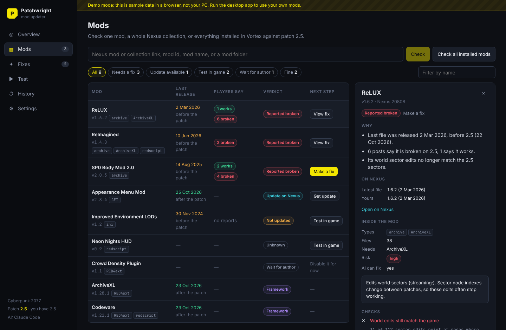
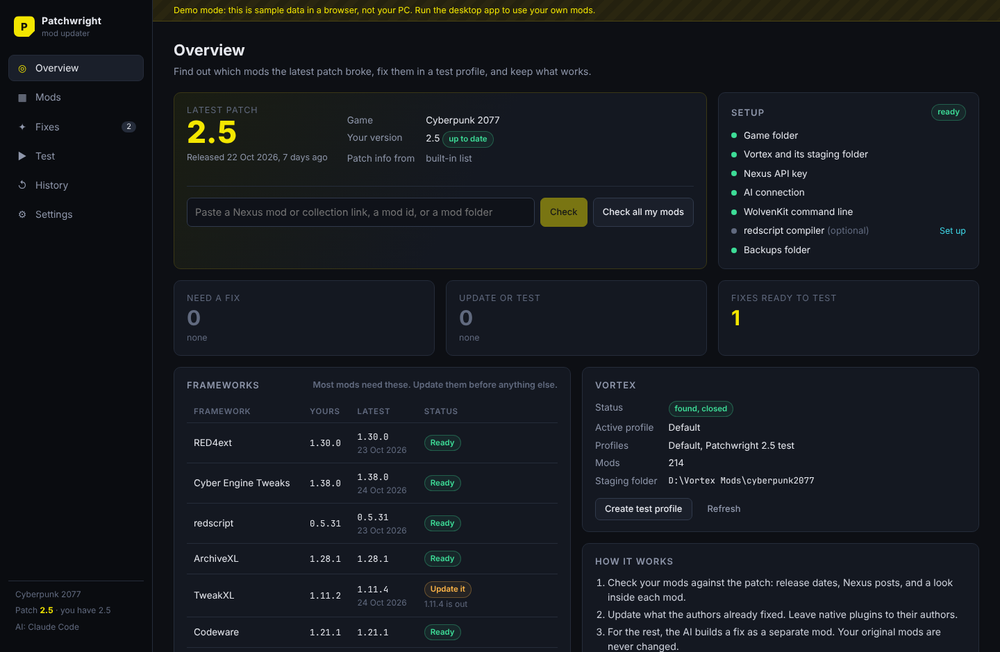
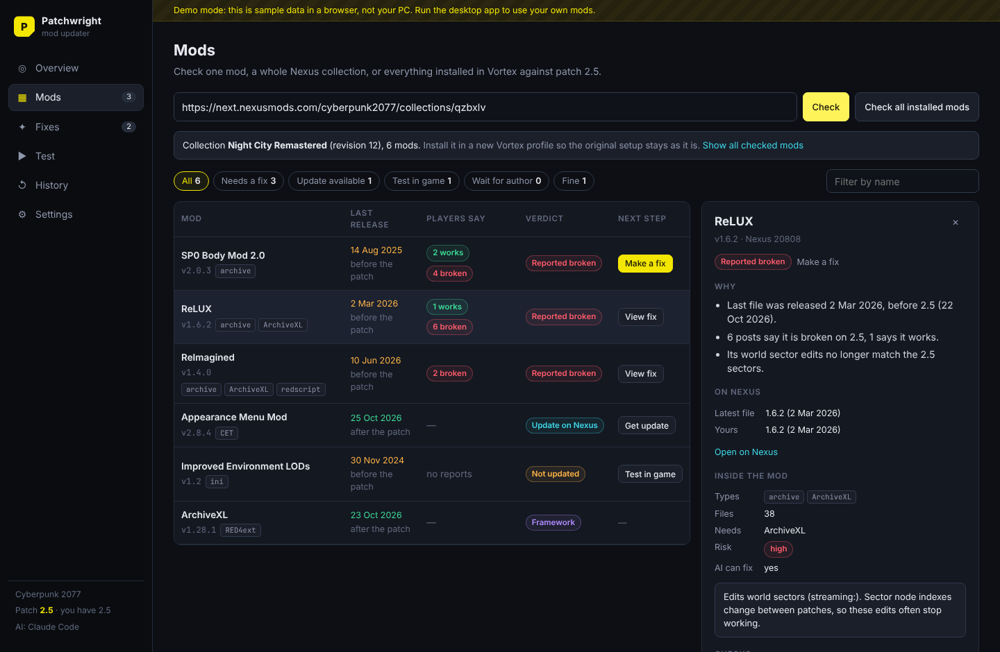
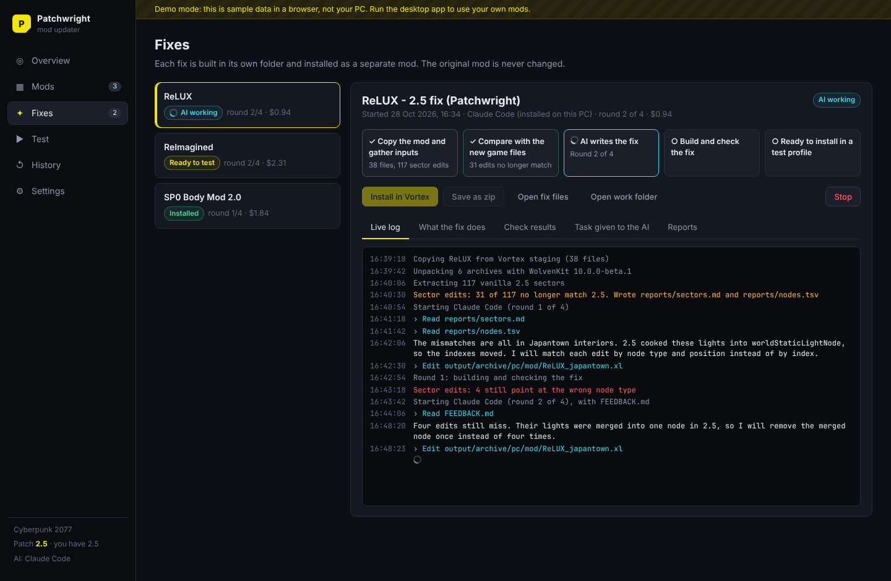
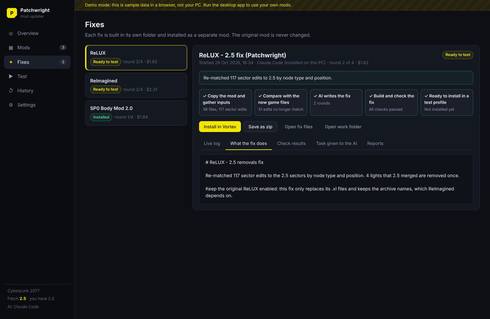
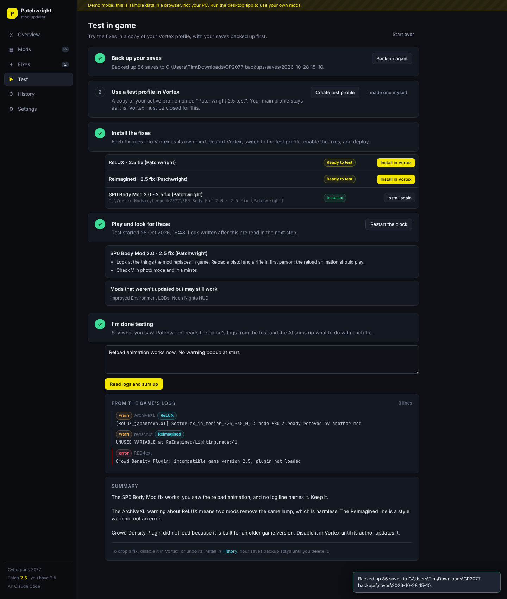
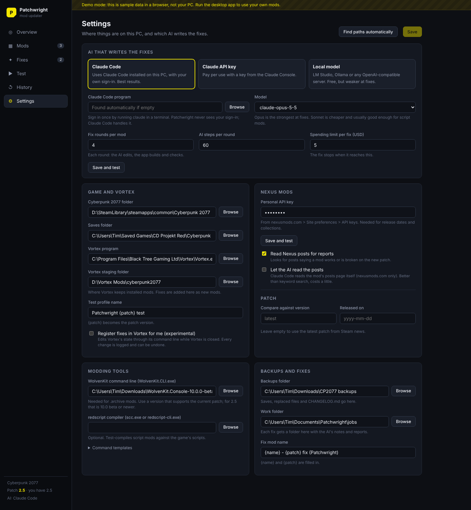

# Patchwright

Patchwright helps you keep your game mods working after a game patch. It finds out which mods the patch broke, fixes the ones it can with an AI, and lets you test every fix safely in a separate Vortex profile.

It starts with **Cyberpunk 2077** and **Vortex**. The game-specific parts sit behind one interface, so other games can be added later.



## What it does

1. **Finds the latest patch.** It reads the game's patch announcements from Steam news, with a built-in list as a fallback, and compares mods against the latest content patch (for example 2.5). Hotfixes (2.51) are tracked separately.
2. **Checks your mods.** You can check one mod (a Nexus link, id or folder), a whole Nexus collection, or everything installed in Vortex. For each mod it looks at:
   - the release date of the mod's latest file compared with the patch date, and whether you have that file;
   - what the mod page and players' posts say about the patch (keyword scan, or the AI reads the posts);
   - what is inside the mod: archives, ArchiveXL, TweakXL, redscript, CET, native plugins;
   - whether the frameworks it needs (RED4ext, ArchiveXL, Codeware…) are ready for the patch;
   - concrete checks: script compile errors, world-sector edits that no longer match the game, errors in the game's logs.
3. **Recommends a next step** for each mod: nothing to do, update in Vortex, update a framework first, test it in game, make a fix, or wait for the author (for native plugins, which only their author can rebuild).
4. **Makes a fix** when needed. The AI works in a copy of the mod and writes a **separate fix mod**. The app does the unpacking, packing, compiling and checking between AI rounds, and sends the results back to the AI until the checks pass.
5. **Tests in game.** It backs up your saves, creates a test profile in Vortex (a copy of your active profile), installs the fixes there, tells you what to look at, then reads the game's logs and sums up the test.
6. **Keeps a history.** Everything it changes on your PC is logged with an Undo button, and also written to `CHANGELOG.md` in your backups folder.

## Safety rules

These rules are built into the app, not just recommended:

- **Original mods and game files are never edited.** The AI works on a copy in a job folder. A fix is always a new mod folder in Vortex's staging folder (or a zip), so you can turn it off in Vortex at any time.
- **Nothing is written into the game folder.** Vortex deploys the fix like any other mod.
- **The AI has no shell.** It can only read the job folder and write a few paths inside it (`output/`, `src/`, `recipe.json`, `fix.json`, `NOTES.md`, `requests.json`). The app runs every tool itself with fixed commands.
- **Undo moves things aside; it never deletes.** Replaced files go to `backups/replaced`, undone ones to `backups/undone`.
- **Saves are backed up** before testing.
- **Vortex's state is only changed when you turn it on** (Settings > "Register fixes in Vortex for me"), only while Vortex is closed, and every change can be undone.
- **Mod permissions:** fixes are built for your own use. Many authors don't allow re-uploads or patches of their work. Check the mod's permissions before you share a fix.

## AI options

| | How it connects | Notes |
|---|---|---|
| **Claude Code** (default) | Runs the Claude Code program installed on your PC, in headless mode | Best results. You sign in to Claude Code yourself, once, in a terminal. Patchwright never sees or stores your sign-in. Edits are limited with Claude Code's own permission rules, and Bash is turned off. |
| **Claude API key** | Calls the Claude API with your key | Pay per use. The key is stored encrypted on your PC (Windows DPAPI via Electron's safeStorage). |
| **Local model** | Any OpenAI-compatible server: LM Studio, Ollama, llama.cpp | Free and offline. Needs a model with tool calling and a long context. Weaker at fixes; best for small script mods. |

You can set a spending limit per fix and the number of fix rounds in Settings.

## Requirements

- Windows 10 or 11
- Cyberpunk 2077 and Vortex
- A Nexus Mods account with a personal API key (for release dates and collections)
- [WolvenKit](https://github.com/WolvenKit/WolvenKit) command line (`WolvenKit.CLI.exe`) in a version that supports the current patch. For patch 2.5 that is 10.0 beta or newer, because earlier versions can't read the 2.5 world sectors.
- Optional: the redscript command line compiler, to test-compile script mods
- One of the AI options above

## Getting started

```bash
npm install
npm run dev          # run the desktop app in development
npm run dist:win     # build a Windows installer and a portable .exe into dist/
```

To look at the interface without Electron, run it in a browser with demo data:

```bash
npm run preview:web  # http://127.0.0.1:5199
```

Other scripts: `npm test` runs the unit tests, `npm run typecheck` checks types.

On first start, open **Settings**, press **Find paths automatically**, check what it found, pick an AI, and save.

## How a fix is made

Each fix runs in its own job folder (`Documents\Patchwright\jobs\<mod> <id>`):

```
original/      copy of the mod (read only)
unpacked/      the mod's archives, unpacked and converted to JSON by WolvenKit
vanilla/       the same files from the current game version, for comparison
reports/       what changed: asset differences, stale sector edits, compile errors, log lines
TASK.md        the task for the AI
PLAYBOOK.md    what has worked before for this game
FEEDBACK.md    results of the last build and checks
output/        the fix mod, laid out like the game folder
recipe.json    optional: bulk edits of game files (see below)
fix.json       "addon" (works next to the original) or "replace" (the original must be disabled)
NOTES.md       the AI's description of the fix and how to test it
```

A job goes through these steps:

1. **Prepare.** Copy the mod, unpack its archives, extract the matching files from the current game, and write reports.
2. **AI round.** The AI reads `TASK.md` and the reports and writes the fix. It can ask for more game files in `requests.json`; the app extracts them and starts the next round.
3. **Build and check.** The app applies `recipe.json`, packs archives, test-compiles scripts, parses YAML, checks sector edits against the game, checks the folder layout, and makes sure the fix doesn't overwrite other mods. Failures go to `FEEDBACK.md` and the AI gets another round.
4. **Ready.** When everything passes, you install the fix into Vortex from the Fixes page and test it.

**Recipes** let the AI rebuild many game files without writing each one out. A recipe copies a source file (from the game, the mod, or the AI's own `src/`) and applies a few edits by path. For example, the SP0 Body Mod fix needed the five 2.5 player entity files rebuilt for each of 32 body sizes, with only the rig path changed. That is one short recipe instead of 160 hand-written files.

## Status

Built and tested:

- the engine: patch detection, Nexus mod and collection lookups, Vortex staging scan and state access, mod checks, fix jobs, delivery, changelog and undo
- an end-to-end run on a fake PC (`tests/engine.test.ts`), with a fake Vortex command line and a scripted AI: check a mod, build a fix, install it, register it in Vortex, undo both
- 56 unit tests in total, and type checks for the main and UI code
- the UI, in a browser with demo data (screenshots below)

Not yet tested on a real PC:

- the Electron app window itself (the build environment could not download Electron)
- the real Vortex command line (`--get`, `--set`, `--del`), real WolvenKit and redscript commands, and live Nexus and Steam calls

The WolvenKit and redscript command lines are configurable templates (Settings > Modding tools > Command templates) in case a tool version uses different arguments.

## Project layout

```
src/shared/          types and the UI API shared by both sides
src/core/            the engine (plain Node, no Electron)
  engine.ts          one object the UI talks to
  games/             one adapter per game; cyberpunk2077/ has the classifier, checks, tools and playbook
  sources/           Steam news, Nexus API, Nexus posts
  vortex/            Vortex state and staging folder
  ai/                Claude Code, Claude API and local model backends, and the AI's file tools
  workflow/          triage, fix jobs, recipes, prompts, testing, changelog
src/main/            Electron main process: window, IPC, encrypted secrets
src/preload/         exposes the engine API to the UI
src/renderer/        React UI (mock.ts holds the demo data)
tests/               vitest tests
docs/                architecture notes, improvement ideas, screenshots
```

More detail: [docs/ARCHITECTURE.md](docs/ARCHITECTURE.md). Ideas for what to build next: [docs/IMPROVEMENTS.md](docs/IMPROVEMENTS.md).

## Screenshots

| | |
|---|---|
|  |  |
|  |  |
|  |  |

## License

MIT. See [LICENSE](LICENSE).

Patchwright is not affiliated with CD PROJEKT RED, Nexus Mods, Black Tree Gaming (Vortex), or the WolvenKit team.
